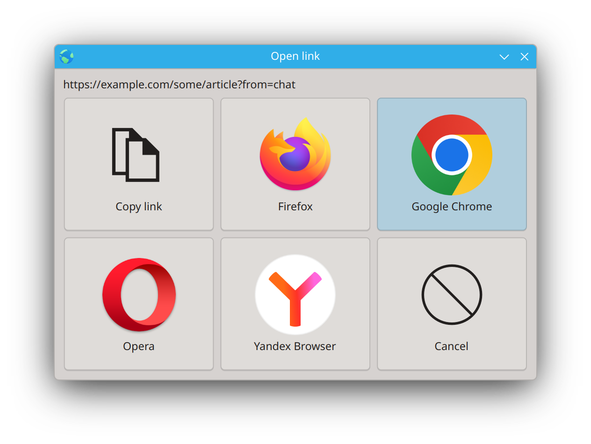

🇬🇧 English | [🇷🇺 Русский](README.ru.md)

# kde-browser-chooser

Click a link anywhere in KDE Plasma 6, and this window asks which browser should open it. One click on a large tile is enough.



- **Finds your browsers by itself**: packages, snaps and Flatpaks. Install another browser, and its tile appears.
- **Brings the browser to the front**, even one that is already running. On Wayland that takes [a token](#why-it-asks-kwin-for-a-token).
- **Copies the link** if you would rather paste it somewhere.
- **Works from the keyboard**: Enter opens the last choice, the arrow keys walk the grid, Esc cancels.
- **Needs no settings**, but [has some](#settings): order, names, hidden tiles, tiles of your own.
- **Speaks English and Russian.** Another language is one more file in [locales](src/kde_browser_chooser/locales).

## Install

```sh
curl -fsSL https://raw.githubusercontent.com/zinin/kde-browser-chooser/master/install.sh | sh
```

[install.sh](install.sh) takes the [latest release](https://github.com/zinin/kde-browser-chooser/releases/latest), checks it against its `SHA256SUMS` and puts one file into `~/.local/bin`. It offers to install PyQt6, if you lack it, and to make the program your default browser. Only PyQt6 needs root. Run the command again to update.

To remove the program and get your previous default browser back:

```sh
curl -fsSL https://raw.githubusercontent.com/zinin/kde-browser-chooser/master/install.sh | sh -s -- --uninstall
```

`--uninstall --purge` removes the settings too, `--yes` accepts every suggestion, `--no-default` leaves the default browser alone, and `--version 0.1.0` picks another release. `KBC_INSTALL_DIR` names another directory: `curl … | KBC_INSTALL_DIR=/opt/bin sh`.

## Requirements

- KDE Plasma 6.
- Python 3.11 or later as `/usr/bin/python3`.
- PyQt6 from your distribution. Every Kubuntu 26.04 has it. PyQt6 from pip will not do: it brings a Qt of its own, without the Breeze style.

The installer is tested on Ubuntu 26.04, Debian 13, Fedora, Arch and openSUSE Tumbleweed, the window on Kubuntu 26.04 with Plasma 6.6 on Wayland. On systems based on ostree add PyQt6 yourself: `rpm-ostree install python3-pyqt6`. NixOS is not supported.

## Settings

The program reads `~/.config/kde-browser-chooser/config.toml`, if you have one. [config.example.toml](config.example.toml) shows all it understands:

```toml
language = "ru"                                       # default: the language of the session
order = ["copy", "google-chrome", "firefox_firefox"]  # the rest follow, by name
hide = ["opera"]                                      # "copy" can be hidden too
rename = { "yandex-browser" = "Yandex" }

[[tile]]                                              # a tile of your own
id = "chrome-work"                                    # default: made from the name
name = "Chrome: work"
icon = "google-chrome"                                # icon theme name or path; optional
command = "google-chrome-stable --profile-directory='Profile 1'"  # links replace %u or %U, or go last
```

`kde-browser-chooser --list` prints the ids. A mistake in the file blocks no link: the window opens as if the file were not there, and a notification names the mistake.

## Which browsers it finds

Every program whose desktop entry handles `https` links and passes them in `Exec`, unless the entry is hidden, runs in a terminal, is meant for another desktop or names a missing program in `TryExec`. Two entries with the same command make one tile. Konqueror keeps its handler in a hidden entry, so add it as a tile of your own.

## Why it asks KWin for a token

On Wayland no window may come to the front by itself. The program you click a link in gets a token from KWin, a proof of that click, and passes it on. But the next click, on a tile, makes that token stale, and the browser would stay behind other windows. So the window asks KWin for a new token and hands it to the browser in `XDG_ACTIVATION_TOKEN`. If KWin does not answer in 0.3 seconds, the link opens all the same.

## Good to know

- On X11 the window works, but asks for no token.
- The link goes to the clipboard through `wl-copy`, if you have it, else through Klipper. Klipper also replaces the selection that the middle button pastes.
- For the first 0.3 seconds the tiles ignore clicks, so that a double click on a link chooses nothing. One click on a tile is enough; a second one lands in the window beneath it.
- Without PyQt6 you get a plain kdialog list, and a running browser may stay behind.
- `.html` files open through the window too.

## If something is wrong

- **Links still open in the old browser.** Restart the program you click them in: it remembers the old default.
- **A list instead of tiles.** PyQt6 is missing: check with `/usr/bin/python3 -I -c 'import PyQt6.QtWidgets'`.
- **"Could not start …"** That browser has moved or is gone.
- **Anything else.** Run `~/.local/bin/kde-browser-chooser https://example.com` in a terminal and read what it says. For links clicked elsewhere, look into `journalctl --user -b`.

## License

[MIT](LICENSE)
