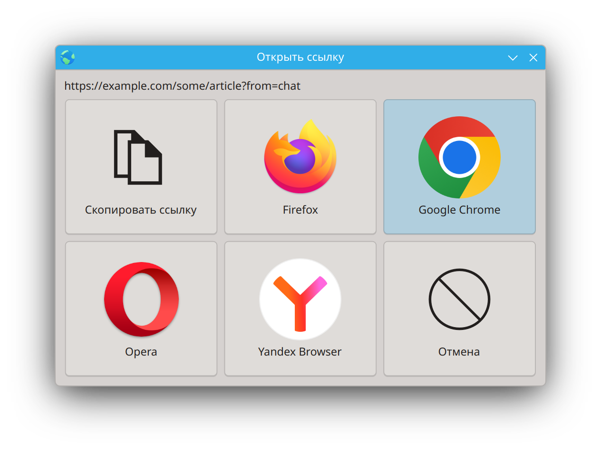

[🇬🇧 English](README.md) | 🇷🇺 Русский

# kde-browser-chooser

Щёлкните ссылку где угодно в KDE Plasma 6, и окно спросит, в каком браузере её открыть. Достаточно одного щелчка по большой плитке.



- **Сам находит браузеры**: из пакетов, snap и Flatpak. Поставите ещё один — появится его плитка.
- **Выводит браузер вперёд**, даже если он уже запущен. На Wayland для этого нужен [токен](#зачем-токен-kwin).
- **Копирует ссылку**, если вы хотите вставить её куда-то ещё.
- **Слушается клавиатуры**: Enter открывает прошлый выбор, стрелки ходят по сетке, Esc отменяет.
- **Работает без настроек**, но [они есть](#настройки): порядок, названия, скрытые плитки, свои плитки.
- **Говорит по-английски и по-русски.** Новый язык — ещё один файл в [locales](src/kde_browser_chooser/locales).

## Установка

```sh
curl -fsSL https://raw.githubusercontent.com/zinin/kde-browser-chooser/master/install.sh | sh
```

[install.sh](install.sh) берёт [последний релиз](https://github.com/zinin/kde-browser-chooser/releases/latest), сверяет его с `SHA256SUMS` и кладёт один файл в `~/.local/bin`. Он предлагает сделать программу браузером по умолчанию, а если нет PyQt6 — сначала поставить и его. Права root нужны только для PyQt6. Та же команда обновляет программу.

Удалить программу и вернуть прежний браузер по умолчанию:

```sh
curl -fsSL https://raw.githubusercontent.com/zinin/kde-browser-chooser/master/install.sh | sh -s -- --uninstall
```

`--uninstall --purge` удаляет и настройки, `--yes` соглашается со всем предложенным, `--no-default` не трогает браузер по умолчанию, `--version 0.1.0` выбирает другой релиз. Другой каталог задаёт `KBC_INSTALL_DIR`: `curl … | KBC_INSTALL_DIR=/opt/bin sh`.

## Что нужно

- KDE Plasma 6.
- Python 3.11 или новее в `/usr/bin/python3`.
- PyQt6 из вашего дистрибутива. В Kubuntu 26.04 он есть всегда. PyQt6 из pip не подойдёт: он приносит свой Qt, без стиля Breeze.

Установщик проверен в Ubuntu 26.04, Debian 13, Fedora, Arch и openSUSE Tumbleweed, окно — в Kubuntu 26.04 с Plasma 6.6 на Wayland. В системах на ostree добавьте PyQt6 сами: `rpm-ostree install python3-pyqt6`. NixOS не поддерживается.

## Настройки

Программа читает `~/.config/kde-browser-chooser/config.toml`, если он есть. Всё, что она понимает, — в [config.example.toml](config.example.toml):

```toml
language = "ru"                                       # по умолчанию — язык сеанса
order = ["copy", "google-chrome", "firefox_firefox"]  # остальные следом, по названию
hide = ["opera"]                                      # можно скрыть и "copy"
rename = { "yandex-browser" = "Яндекс Браузер" }

[[tile]]                                              # своя плитка
id = "chrome-work"                                    # по умолчанию — из названия
name = "Chrome: работа"
icon = "google-chrome"                                # имя из темы или путь; необязательно
command = "google-chrome-stable --profile-directory='Profile 1'"  # ссылки встают на место %u или %U либо в конец
```

`kde-browser-chooser --list` печатает ID. Ошибка в файле не мешает открыть ссылку: окно покажется так, будто файла нет, а уведомление назовёт ошибку.

## Какие браузеры он находит

Все программы, чья запись `.desktop` открывает ссылки `https` и передаёт их в `Exec`, если запись не скрыта, не запускается в терминале, не предназначена другому рабочему столу и не называет в `TryExec` отсутствующую программу. Две записи с одной командой — одна плитка. У Konqueror обработчик лежит в скрытой записи, поэтому добавьте его своей плиткой.

## Зачем токен KWin

На Wayland окно не может само выйти вперёд. Программа, в которой вы щёлкнули ссылку, получает от KWin токен — подтверждение щелчка — и передаёт его дальше. Но следующий щелчок, по плитке, делает этот токен устаревшим, и браузер остался бы позади других окон. Поэтому окно просит у KWin новый токен и отдаёт его браузеру в `XDG_ACTIVATION_TOKEN`. Не ответит KWin за 0,3 секунды — ссылка всё равно откроется.

## Что стоит знать

- На X11 окно работает, но токен не просит.
- Ссылка копируется через `wl-copy`, если он есть, иначе через Klipper. Klipper заменяет и то, что вставляет средняя кнопка.
- Первые 0,3 секунды плитки не принимают щелчки, чтобы двойной щелчок по ссылке ничего не выбрал. По плитке достаточно одного щелчка: второй попадёт в окно под ней.
- Без PyQt6 вместо плиток — простой список kdialog, и запущенный браузер может остаться позади.
- Файлы `.html` тоже открываются через окно.

## Если что-то не так

- **Ссылки открываются в прежнем браузере.** Перезапустите программу, в которой щёлкаете: она помнит старый браузер.
- **Список вместо плиток.** Нет PyQt6; проверить: `/usr/bin/python3 -I -c 'import PyQt6.QtWidgets'`.
- **«Не удалось запустить …»** Этот браузер переехал или удалён.
- **Что-то ещё.** Выполните в терминале `~/.local/bin/kde-browser-chooser https://example.com` и прочтите вывод. Если ссылка щёлкнута в другой программе, смотрите `journalctl --user -b`.

## Лицензия

[MIT](LICENSE)
